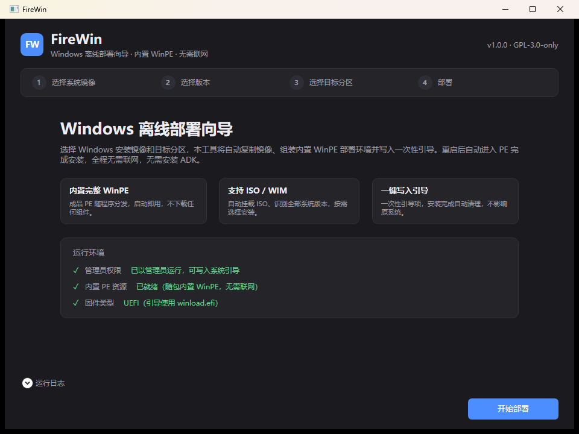
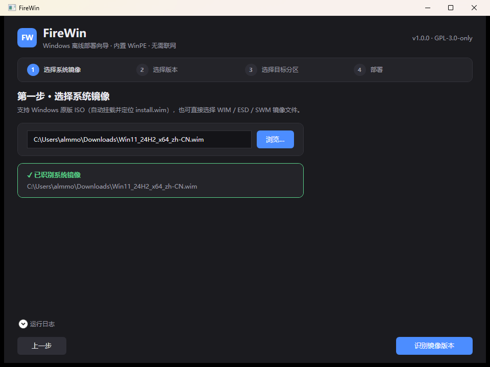
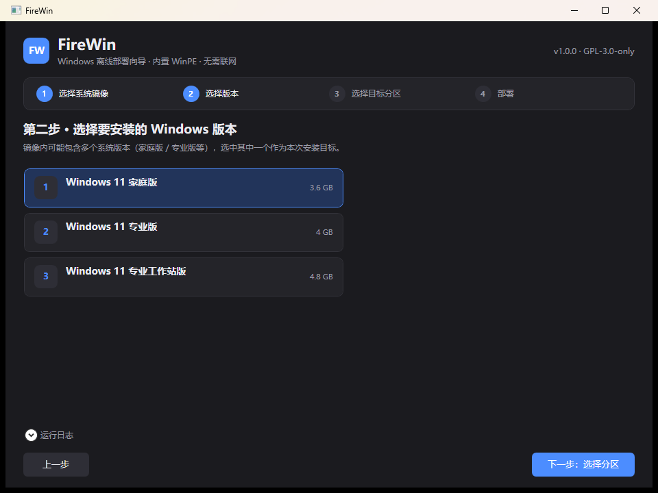
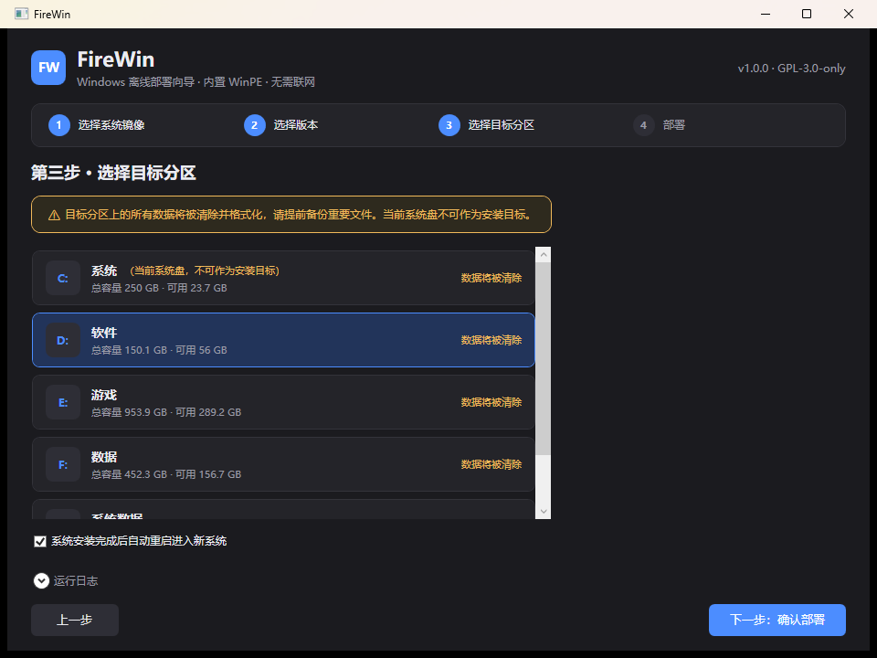
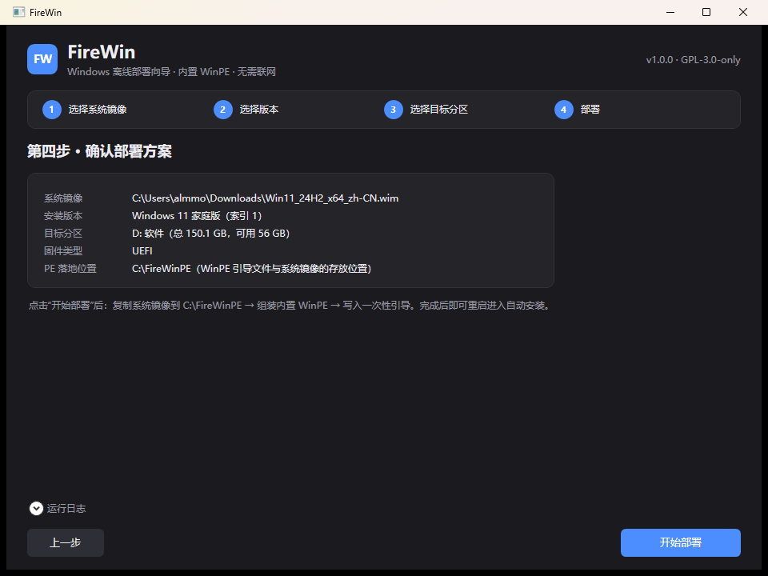

# FireWin

Windows 离线部署工具，多功能集于一体：

- **二合一入口**（桌面端）：同一个 exe、同一个目录，启动后选择「一键安装系统」或「制作 PE」，两个功能不再分成两套程序；
- **系统部署向导**（桌面端）：**四步部署**（选镜像 → 选版本 → 选分区 → 一键部署），内置完整 WinPE，自动写入一次性引导，重启后自动安装系统——全程无需联网、无需安装 ADK；
- **制作 PE 启动盘 / 生成 ISO**（桌面端）：把内置 WinPE 写入 U 盘（隐藏启动分区 + 正常数据分区，UEFI / Legacy BIOS 双引导），或生成可启动 ISO（内置 ISO9660 + El Torito 写入器，不依赖 ADK / oscdimg）；
- **镜像目录 `FWIMG`**：制作时自动在数据分区（或 ISO 根目录）创建，往里放 WIM / ESD / SWM / ISO 即可，PE 端优先扫描 `\FWIMG`、兼容旧的 `\Images`；
- **PE 端**：裸 WinPE 双击即用，既按 `deploy.json` 自动部署，也能独立扫描 `FWIMG` / `Images` 目录选镜像安装。

**许可证：GPL-3.0-only**。允许商业使用；任何基于本项目的衍生发布必须同样以 GPL-3.0 开源。

## 产品预览

桌面端四步向导（深色控制台风格，高分屏适配）：

| | |
|---|---|
|  |  |
|  |  |



- **欢迎页**：管理员权限、内置 PE 资源、固件类型一目了然，无需任何环境配置；
- **选择镜像**：Windows 原版 ISO 自动挂载并定位 `install.wim`，也支持直接选择 WIM / ESD / SWM；
- **选择版本**：wimlib 枚举镜像内全部 Windows 版本（家庭版 / 专业版 / 专业工作站版）及实际体积；
- **选择分区**：当前系统盘自动禁选并标记，数据清除警告醒目；
- **确认部署**：复制镜像到 `C:\FireWinPE` → 组装内置 WinPE → 写入一次性引导 → 重启即进入自动安装。

## 1. 为什么是两个二进制

| | 桌面端 | PE 端 |
|---|---|---|
| 语言 / 框架 | C# 12 / .NET 8 + WPF | C++17 / Win32 API |
| 发布 | 自包含单文件（win-x64） | 静态 CRT（`/MT`），单 exe |
| 镜像处理 | ManagedWimLib（LGPLv3） | 子进程调用 `wimlib-imagex.exe` |
| 存在理由 | 四步部署向导、镜像识别、引导写入 | **裸 PE 双击即用**，零运行时依赖 |

WinPE 是微软裁剪过的运行环境：没有 .NET 运行时，也不支持 WPF。PE 端因此必须是原生 exe，并把 wimlib / 7-Zip 一律当子进程调用——这是环境约束，不是能靠「自动注入运行时」绕过的问题。

## 2. 目录结构

```
src/FireWin/                桌面端（.NET 8 / WPF）
  FireWin.csproj
  app.manifest                       启动即请求管理员权限（写引导需要 bcdedit）
  App.xaml / App.xaml.cs             入口：无参数开选择页，带参数走命令行
  LauncherWindow.xaml / .xaml.cs     启动选择页：「一键安装系统」/「制作 PE」
  MainWindow.xaml / .xaml.cs         主窗口：四步部署向导（镜像 → 版本 → 分区 → 部署）
  UsbWindow.xaml / .xaml.cs          制作 PE 窗口：写入 U 盘 / 生成 ISO 两种模式
  Services/
    WimInitService.cs                libwim-15.dll 定位 + wimlib 全局初始化
    DeployService.cs                 ISO 挂载 / WIM 版本枚举 / 分区枚举 / 镜像带进度复制
    AdkInstaller.cs                  ADK / WinPE 附加组件检测与静默安装（仅命令行 / 重建 PE 时使用）
    BcdBootService.cs                组装 C:\FireWinPE + deploy.json + 临时引导写入（bcdedit + bootsequence）
    UsbBootService.cs                U 盘枚举（IOCTL）/ diskpart 双分区 / PE 写入 / 隐藏启动分区 / U 盘独立 BCD / bootsect
    IsoImageService.cs               自研 ISO9660 + El Torito 写入器（UEFI + BIOS 双引导，无需 ADK）
pe/                                  PE 端（C++17 / Win32）
  CMakeLists.txt
  drivers/                           基础驱动目录（放 .inf 驱动包，构建时自动注入 boot.wim）
  main.cpp                           桌面外壳（壁纸 / 桌面图标 / 任务栏 / 开始菜单，`/shell` 为经典启动器）+ 读 deploy.json → wimlib-imagex apply → bcdboot → 清理 BCD；无 deploy.json 时支持「安装系统」（优先扫描 \FWIMG、兼容 \Images、选版本、选分区），另有「加载驱动」（\Drivers 扫描 + drvload）与「网络初始化」
  boottool.cpp                       FireBoot 独立引导工具（写 PE 引导 / 修复系统引导 / 查看 BCD）
  apps/                              常用工具（构建时注入 PE 的 \Tools\Apps\）
    Explorer++/Explorer++.exe        文件管理器
    7-Zip/7zFM.exe                   压缩包浏览 / 解压
    Notepad++/notepad++.exe          文本编辑
scripts/
  install-adk.ps1                    ADK 主包 + WinPE 附加组件静默安装
  build-minipe.ps1                   构建迷你 PE（boot.wim / ISO）
tools/                              已下载的 PE 端第三方文件（含许可证文本）
  wimlib-imagex.exe / libwim-15.dll  wimlib 1.14.4 官方 Windows x64 二进制
  7za.exe                            7-Zip 25.01 Extra（x64 独立版）
  screenshot-demo.ps1                宣传图自动截图脚本（UIA 驱动向导翻页）
downloads/                          离线资源（可选）
  adk/adksetup.exe、adkwinpesetup.exe   ADK 主包与 WinPE 附加组件官方引导器
  nuget/managedwimlib.2.6.0.nupkg     ManagedWimLib NuGet 包
  vs_buildtools.exe                  VS 2022 生成工具引导器（编译 PE 端用）
payload/pe/                         随桌面端分发的成品 PE（唯一内置资源）
  boot.wim / boot.sdi               PE 镜像与 ramdisk 引导盘
  Tools/                            FireWinPE.exe、FireBoot.exe、wimlib-imagex.exe、libwim-15.dll、7za.exe
dist/desktop/                       已发布的桌面端单文件 exe（同级带 payload\pe\）
```

`tools\` 中的文件已随本仓库提供。`libwim-15.dll` 也可直接从 ManagedWimLib NuGet 包的 `runtimes\win-x64\native\` 中取得。

## 3. 依赖与许可证

| 组件 | 许可证 | 集成方式 |
|---|---|---|
| 本项目全部代码 | GPL-3.0-only | — |
| ManagedWimLib 2.6.0 | LGPL-3.0-or-later | NuGet，随桌面端分发 |
| wimlib-imagex.exe / libwim-15.dll | LGPLv3+ / GPLv3+ | 随 PE 端分发，附许可证 |
| 7za.exe | LGPL | 子进程调用 |
| .NET 8 运行时 | MIT | 自包含嵌入桌面端 |

> 分发 `wimlib-imagex.exe` 与 `libwim-15.dll` 时，请一并附带 wimlib 的许可证文本与源码获取方式。

## 4. 构建

### 4.1 桌面端

```powershell
dotnet publish src\FireWin\FireWin.csproj -c Release -r win-x64 `
  --self-contained true -p:PublishSingleFile=true
```

产物：`dist\desktop\FireWin.exe`（已生成，约 66 MB）

> 本机若未安装 .NET SDK，可用便携版：运行时把 SDK 解压到 `.buildtools\dotnet\`，用 `.buildtools\dotnet\dotnet.exe publish ...` 执行上面的命令。

`IncludeNativeLibrariesForSelfExtract` 已开启，`libwim-15.dll` 会打进单文件并在运行时自解压；`WimInitService` 同时支持「exe 同目录」「runtimes\win-x64\native\」「自解压目录」三种位置。

### 4.2 PE 端

```powershell
cmake -S pe -B pe\build -G "Visual Studio 17 2022" -A x64
cmake --build pe\build --config Release
```

> 本机未安装 MSVC 时先运行 `downloads\vs_buildtools.exe`，勾选「使用 C++ 的桌面开发」。仓库内的便携 CMake 位于 `.buildtools\cmake\cmake-4.5.0-windows-x86_64\bin\cmake.exe`。

产物：`pe\build\bin\FireWinPE.exe` 与 `pe\build\bin\FireBoot.exe`（独立引导工具）

`CMakeLists.txt` 中 `CMAKE_MSVC_RUNTIME_LIBRARY=MultiThreaded` 强制 `/MT`。验收命令：

```powershell
dumpbin /dependents pe\build\bin\FireWinPE.exe
```

输出中不应出现 `VCRUNTIME140.dll`、`MSVCP140.dll`，正常只依赖 `KERNEL32.dll`、`USER32.dll` 等系统 DLL。

### 4.3 迷你 PE

```powershell
# 首次：安装 ADK + WinPE 附加组件
.\scripts\install-adk.ps1

# 构建：boot.wim + ISO，并组装桌面端可直接使用的 PE 源目录
.\scripts\build-minipe.ps1 -Language zh-cn -OutputIso .\dist\FireWinPE.iso -AssemblePayload
```

`build-minipe.ps1` 的核心步骤：

1. `copype amd64` 生成基础 PE；
2. 挂载 `boot.wim`，注入 `WinPE-WMI → WinPE-NetFx → WinPE-Scripting → WinPE-PowerShell`（含语言包）；`-Language zh-cn` 时额外注入 `WinPE-FontSupport-ZH-CN`，否则启动器里的中文会显示成方块；
3. 把 `FireWinPE.exe`、`FireBoot.exe`、`wimlib-imagex.exe`、`libwim-15.dll`、`7za.exe` 复制到挂载目录 `\Tools\`；
   - 3.5 若 `pe\apps\`（可用 `-AppsDirectory` 指定其它目录）存在，把其下所有文件递归复制到 `\Tools\Apps\`，保持子目录结构；不存在时只告警并跳过；
4. 修改 `startnet.cmd`，在 `wpeinit` 之后追加 `X:\Tools\FireWinPE.exe`（进入图形启动器，由用户先选工具再安装）；
5. `/Unmount-Image /Commit`，`MakeWinPEMedia /ISO` 导出；
6. `-AssemblePayload` 时额外产出 `payload\pe\`（`boot.wim` + `boot.sdi` + `Tools\`），即桌面端随包分发的成品 PE。

> 桌面端只内置成品 PE（`payload\pe\`），**不内置 ADK 安装包**：ADK 仅在重新制作 PE 时需要，这几百 MB 到数 GB 的安装包与本工具日常运行无关。`payload\pe\` 完整时，桌面端直接解压 PE 并写引导，无需检测或安装 ADK。
>
> 发布时 `payload\pe\` 会被原样复制到 exe 同级目录（`dist\desktop\payload\pe\`）；缺少 `boot.wim` / `boot.sdi` / `FireWinPE.exe` 时，欢迎页的「内置 PE 资源」会显示缺失清单，此时需先构建 PE 端并重新执行上面的 `build-minipe.ps1 -AssemblePayload`。

> 注入顺序说明：设计文档给出的顺序是 WMI→NetFx→PowerShell→Scripting，但 `WinPE-PowerShell` 依赖 `WinPE-Scripting`，`WinPE-NetFx` 依赖 `WinPE-WMI`。脚本按依赖顺序执行，否则 DISM 会因依赖缺失报错。

> `WinPE-NetFx` 只有 PE 端程序需要加载 .NET 组件时才有意义。本项目的 PE 端是纯原生 C++，不需要它；可以删掉该项以减小 `boot.wim` 体积。

## 5. 使用流程

### 5.1 桌面端（正常 Windows 中运行）

双击 `FireWin.exe` 即可（带 `requireAdministrator` 清单，UAC 自动提权）。先进入**启动选择页**：点「一键安装系统」进入四步部署向导，点「制作 PE」进入 PE U 盘 / ISO 制作窗口（见 5.2）。向导共四步：

1. **欢迎页**：确认管理员权限、内置 PE 资源、固件类型（UEFI / BIOS 自动检测）；
2. **第一步 · 选择系统镜像**：选 Windows 原版 ISO（自动挂载并定位 `sources\install.wim` / `install.esd`），或直接选择 WIM / ESD / SWM 镜像；
3. **第二步 · 选择版本**：wimlib 枚举镜像索引，列出全部 Windows 版本与体积；
4. **第三步 · 选择目标分区**：列出全部本地固定磁盘分区，当前系统盘自动禁选；可选择部署完成后是否自动重启；
5. **第四步 · 确认部署**：确认方案后工具自动完成：

```text
复制系统镜像 → C:\FireWinPE\install.wim     （带百分比进度，PE 端从本地磁盘读取，不依赖光驱）
复制内置 PE   → C:\FireWinPE\{boot.wim, boot.sdi, Tools\}
生成          → C:\FireWinPE\deploy.json     （卷 GUID 路径，PE 端盘符漂移免疫）
写入一次性引导（bcdedit，失败自动回滚）
```

其中一次性 PE 引导的 bcdedit 序列：

```text
bcdedit /create {ramdiskoptions} /d "FireWin RAMDisk Options"
bcdedit /set {ramdiskoptions} ramdisksdidevice partition=C:
bcdedit /set {ramdiskoptions} ramdisksdipath \FireWinPE\boot.sdi

bcdedit /create /d "FireWin PE" /application osloader      → 得到 {GUID}
bcdedit /set {GUID} device ramdisk=[C:]\FireWinPE\boot.wim,{ramdiskoptions}
bcdedit /set {GUID} osdevice ramdisk=[C:]\FireWinPE\boot.wim,{ramdiskoptions}
bcdedit /set {GUID} path \Windows\System32\boot\winload.efi          （UEFI）
bcdedit /set {GUID} systemroot \Windows
bcdedit /set {GUID} winpe yes

bcdedit /bootsequence {GUID}
shutdown /r /t 0
```

`/bootsequence` 只对下一次启动生效，**不会修改默认启动项**；任一环节失败会自动回滚删除临时项，不会留下坏引导。

6. 重启后自动进入 PE，`startnet.cmd` 调用 PE 端程序开始安装。

### 5.2 制作 PE 启动盘 / 生成 ISO（桌面端）

启动选择页点「制作 PE」进入独立窗口，顶部切换两种输出方式：

**① 写入 U 盘**：选 U 盘 →（可选）附加 ISO / WIM / ESD 镜像 → 「开始制作」。工具自动完成：

```text
diskpart 清盘重新分区（MBR）
  ├─ FAT32 启动分区（卷标 FireWinPE，活动分区，容量按 boot.wim/boot.sdi 实际体积估算并 512MB 对齐，最小 1.5GB）
  └─ exFAT 数据分区（剩余全部空间，卷标 FireData，可存 >4GB 大文件）
写入 PE 引导文件
  ├─ \sources\boot.wim（内置 PE）
  ├─ \boot\boot.sdi
  ├─ \bootmgr                     ← 来自 C:\Windows\Boot\PCAT\bootmgr
  └─ \EFI\Boot\bootx64.efi        ← 来自 C:\Windows\Boot\EFI\bootmgfw.efi
bcdedit /createstore 生成 U 盘独立 BCD（device boot 别名，与盘符无关）
bootsect /nt60 <U盘> /force /mbr  写 BIOS 引导代码（找到 bootsect.exe 时）
创建镜像目录 → 数据分区 \FWIMG\（附「把系统镜像放到这里.txt」）
（可选）复制系统镜像 → 数据分区 \FWIMG\install.<ext>
隐藏启动分区（diskpart remove letter，不分配盘符）
```

**② 生成 ISO**：选输出路径（默认 exe 同级的 `FireWinPE.iso`）→（可选）附加镜像 → 「生成 ISO」。内置 ISO9660 + El Torito 写入器，直接复用本机安装介质自带的引导文件，**不依赖 ADK / oscdimg**：

```text
\BOOTMGR  \BOOT\BCD  \BOOT\BOOT.SDI  \SOURCES\BOOT.WIM
\EFI\BOOT\BOOTX64.EFI  \EFI\MICROSOFT\BOOT\BCD
\FWIMG\INSTALL.<ext>                （可选附加镜像）
El Torito：BIOS → etfsboot.com；UEFI → efisys_noprompt.bin
```

要点：

- **UEFI / Legacy BIOS 双引导**：MBR + FAT32 + 活动分区同时满足两种固件；BCD 中 `path` 写 `winload.efi`，bootmgr 会按固件自动替换为 `winload.exe`，一份 BCD 通吃；
- **双分区与隐藏启动分区**：启动分区只放 PE 引导文件，写完后移除盘符，在「此电脑」里只看到正常的数据分区；UEFI 固件按分区结构启动，不依赖盘符；
- **镜像目录 `FWIMG`**：程序在数据分区（U 盘）或 ISO 根目录自动创建，往里放 WIM / ESD / SWM / ISO 都行；PE 端**优先扫描 `\FWIMG`，兼容旧的 `\Images`**；镜像放在 exFAT 数据分区，不受 FAT32 单文件 4GB 限制；
- **bootsect.exe 缺失时仅警告**：UEFI 启动不受影响，只有 Legacy BIOS 启动需要它。搜索顺序：exe 目录 → exe 目录\tools → 已安装 ADK 的 Deployment Tools；
- **换机启动**：启动盘与制作机器无关，任何 UEFI 或 Legacy BIOS 机器从启动菜单（F12 / F8 / Esc）选 U 盘 / ISO 即可进入 FireWin PE。

### 5.3 PE 端（WinPE 中运行）

`startnet.cmd` 默认进入 FireWin PE 桌面（壁纸 + 桌面图标 + 任务栏 + 开始菜单，操作习惯与 Windows 一致）：

```text
FireWinPE.exe                                     进入桌面模式：双击图标启动工具
FireWinPE.exe /shell                              经典单窗口启动器（桌面异常时的兜底入口）
FireWinPE.exe /autodeploy [/config:<deploy.json>] 无人值守入口
```

桌面图标按 Windows 习惯竖向排列（先填满一列再换右边一列），没有 exe 图标的条目用 GDI 绘制的矢量图标；底部任务栏置顶，含「开始」按钮、已打开窗口按钮与时钟。桌面和开始菜单都提供「开始安装」（仅在找到 `deploy.json` 时显示）、「安装系统」以及常用工具：

- **安装系统**（无 `deploy.json` 时可用，U 盘启动场景的主力功能）：自动扫描所有分区 `\FWIMG` 目录（兼容旧的 `\Images`）中的 WIM / ESD / SWM（也可浏览任意文件）→ wimlib 解析索引并选择 Windows 版本 → 选择安装目标分区与引导分区（UEFI 时自动预选 ESP）→ 确认后走与 `deploy.json` 完全相同的部署流程；
- **动态工具按钮**（参考微PE / 优启通等市面常见 PE 的工具集）：启动器自动扫描 `X:\Tools\Apps\`，识别到就显示按钮、不存在自动隐藏——分区与恢复（`DiskGenius 分区`、`分区表恢复(TestDisk)`、`文件恢复(PhotoRec)`）、系统部署（`WinNTSetup 安装器`、`Dism++ 系统精简`）、硬件信息（`CPU-Z`、`GPU-Z`、`硬盘健康检测(CrystalDiskInfo)`）、系统维护（`任务管理器(Process Explorer)`、`进程高级管理(System Informer)`、`启动项管理(Autoruns)`、`网络连接查看(TCPView)`、`Windows 密码清除(NTPWEdit)`、`虚拟光驱(OSFMount)`、`Everything 搜索`、`Q-Dir 文件管理`）；工具多时窗口自动从 2 列扩到 3~4 列，保证 768p 屏幕也能一屏放下。把工具放进 `pe\apps\<目录>\`（构建时随 PE 打包）或启动盘的 `\Tools\Apps\`（运行时扫描）即可，未知目录也能识别（取第一个 exe，按钮文字为目录名）。运行 `scripts\download-pe-apps.ps1` 可一键从官方渠道下载工具到 `pe\apps`（仓库已内置 16 个工具目录：7-Zip、Explorer++、Notepad++、Everything、CPU-Z、Dism++、ProcExp、NTPWEdit、DiskGenius、TestDisk/PhotoRec、System Informer、Q-Dir、Autoruns、TCPView、SDelete）；
- 文件管理器（Explorer++）、7-Zip、Notepad++、记事本、注册表编辑器；
- **加载驱动**：扫描所有分区 `\Drivers` 目录（含 U 盘）中的 INF 并用 `drvload` 现场加载——PE 启动后缺网卡 / 显卡 / 存储控制器驱动时无需重做 PE；构建 PE 时也可以把驱动放进 `pe\drivers\` 由脚本自动注入（见 4.3）；
- **网络初始化**：`wpeutil InitializeNetwork`；
- 命令提示符（工作目录 `X:\`）、磁盘管理（`diskpart`）、引导工具（`FireBoot.exe`：写 PE 引导、修复系统引导、查看 BCD）；
- 重启 / 关机（优先 `wpeutil.exe`，缺失时回退 `ExitWindowsEx`）。

工具从 `X:\Tools\Apps\<工具>\` 以 `CreateProcessW` 拉起，桌面不阻塞；找不到文件时会提示具体路径。未找到 `deploy.json` 时，开始菜单会提示可用「安装系统」扫描 U 盘 `\Images` 直接安装，或先使用工具。

点「开始安装」并确认后，后台线程执行与 `/autodeploy` 完全相同的部署流程：

```text
wimlib-imagex.exe apply "<镜像>" <索引> "<目标分区>" --check
bcdboot.exe "<目标分区>\Windows" /s <引导分区> /f UEFI
bcdedit /delete {GUID} /f
```

完成后弹出结果提示（默认 15 秒后自动重启，可用 `deploy.json` 的 `autoReboot` 关闭）。`/autodeploy` 仍是无人值守入口，行为不变。

**零配置双击即用的技术解释**：PE 端是 `/MT` 静态链接 CRT 的原生 exe，仅依赖 `kernel32/user32` 等系统 DLL；wimlib 与 7-Zip 都以子进程调用，不引入额外 DLL 加载依赖。因此把 `FireWinPE.exe` 放进 `X:\Tools\` 就能直接运行，无需安装 .NET、VC++ 运行库或任何前置组件。

### 5.4 FireBoot 引导工具（独立运行）

`FireBoot.exe` 是独立于部署流程的引导管理小工具，完整 Windows 与 WinPE 均可双击运行（非管理员时执行操作会自动请求提权）：

- **写入 PE 引导**：自动扫描 exe 目录、`payload\pe`、各分区根下的 `\FireWinPE` 等位置寻找 `boot.wim + boot.sdi`，随后按桌面端同一套 bcdedit 序列创建 `{ramdiskoptions}` + osloader 项并设置 `/bootsequence`——只影响下一次启动，不改动默认启动项；
- **删除 PE 引导项**：删除上一次写入的启动项（GUID 记录在 exe 目录 `bootentry.txt`）及 `{ramdiskoptions}`；
- **修复系统引导**：选择 Windows 分区与引导分区，执行 `bcdboot <Windows>\Windows /s <引导分区> /f ALL`；
- **查看当前启动项**：`bcdedit /enum` 输出直接显示在窗口日志框内。

## 6. deploy.json

桌面端写入 `C:\FireWinPE\deploy.json`，PE 端读取：

| 字段 | 说明 |
|---|---|
| `wimPath` | 镜像原始路径（桌面端视角） |
| `wimVolumePath` | 镜像的卷 GUID 路径（`\\?\Volume{...}\...`），PE 端优先使用，避免盘符漂移 |
| `wimIndex` | 要应用的镜像索引，默认 1 |
| `targetDrive` / `targetVolume` | 目标系统分区盘符 / 卷 GUID |
| `systemDrive` / `systemVolume` | 引导分区盘符 / 卷 GUID |
| `firmware` | `UEFI` 或 `BIOS` |
| `bootEntryGuid` | 桌面端创建的一次性 BCD 项，PE 端部署完成后删除 |
| `logPath` | PE 端日志路径，默认 `C:\FireWinPE\deploy.log` |
| `autoReboot` | 部署成功后是否自动重启，默认 `true` |

## 7. 从 7z 获取镜像

原则：**7-Zip 只负责解包，WIM 的解析和部署全部交给 wimlib**。

- 包内是 ISO：`7za x "镜像包.7z" -o"临时目录" -y`，再从中取 `sources\install.wim`；
- 包内直接是 install.wim / install.esd：`7za e "镜像包.7z" "install.wim" -o"输出目录" -y`。

不要用 7-Zip 解压 WIM 内部内容——它对 WIM 的解析不完整，可能造成文件损坏。

## 8. ADK 前置说明

- **ADK 不在随包资源里**：桌面端只内置成品 PE（`payload\pe\`）。ADK 仅在重新制作 PE 时需要，`FireWin.exe --adk-install`（命令行模式）与 `install-adk.ps1` 都是按需在线安装；
- ADK 主包与 WinPE 附加组件是**两个独立安装程序**，都必须安装；
- 检测依据：注册表 `HKLM\SOFTWARE\WOW6432Node\Microsoft\Windows Kits\Installed Roots` 的 `KitsRoot10`，再检查 `Assessment and Deployment Kit\Deployment Tools` 与 `Assessment and Deployment Kit\Windows Preinstallation Environment`；
- 安装顺序：先 `winget install -e --id Microsoft.WindowsADK --silent`，失败回退 `adksetup.exe /quiet /norestart /ceip off /features OptionId.DeploymentTools`；
- WinPE 附加组件：先 `winget install -e --id Microsoft.WindowsADK.WinPEAddon --silent`，失败回退 `adkwinpesetup.exe /quiet /norestart`；
- 安装脚本中的官方直链（`linkid=2289980` / `2289981`）对应 ADK 10.1.26100 系列，微软更新版本后可能需要替换。

## 9. 验证清单

1. **桌面端编译**：`dotnet publish -c Release -r win-x64 --self-contained true -p:PublishSingleFile=true`，产物为单个 exe；
2. **PE 端编译**：CMake 生成 MSVC 工程，`dumpbin /dependents` 确认无 `VCRUNTIME140.dll`，输出单 exe；
3. **制作迷你 PE**：在已安装 ADK 的机器上运行 `build-minipe.ps1`，确认 `\Tools\` 与 `startnet.cmd` 已更新；
4. **虚拟机全链路**：桌面端写入临时引导 → 重启 → 自动进入 PE → 自动部署 → 清理 BCD 项 → 正常进系统；另用 7z 压缩的镜像包重复一次；
5. **PE 启动盘**：桌面端「制作 PE 启动盘」写入 U 盘 → UEFI 虚拟机/真机从 U 盘启动进 PE → 「安装系统」扫描 `\Images` → 安装成功；Legacy BIOS 机器同样验证一次（需 bootsect）。

## 10. 已知限制

- **盘符漂移**：PE 中的盘符与桌面端不一致。`deploy.json` 已保存卷 GUID 路径，PE 端优先按卷解析；若目标分区或 ESP 在 PE 中没有盘符，需要先手动分配（`diskpart` → `assign letter`）。
- **ESP 无盘符**：UEFI 场景下 `bcdboot /s` 需要一个盘符，无障碍的做法是 PE 端先用 `diskpart` 给 ESP 分配临时盘符。
- **`{ramdiskoptions}` 复用**：BCD 中该项是全局的。若已存在，本工具会覆盖其指向；只有本工具创建的项才会在回滚/清理时删除。
- **`boot.sdi` 必需**：ramdisk 引导必须有 `boot.sdi`，桌面端在缺失时会直接报错。
- **unattend.xml 尚未生成**：目标分区上的部署为全自动（wimlib apply + bcdboot），但 OOBE 无人值守应答文件暂未提供，安装后首次进系统需手动完成初始化设置。

## 11. 许可证

Copyright (C) 2026 FireWin contributors

本项目以 **GNU General Public License v3.0 only** 发布。你可以商业使用、修改、分发，但分发衍生作品时必须同样以 GPL-3.0 提供完整源码。详见 <https://www.gnu.org/licenses/gpl-3.0.html>。
